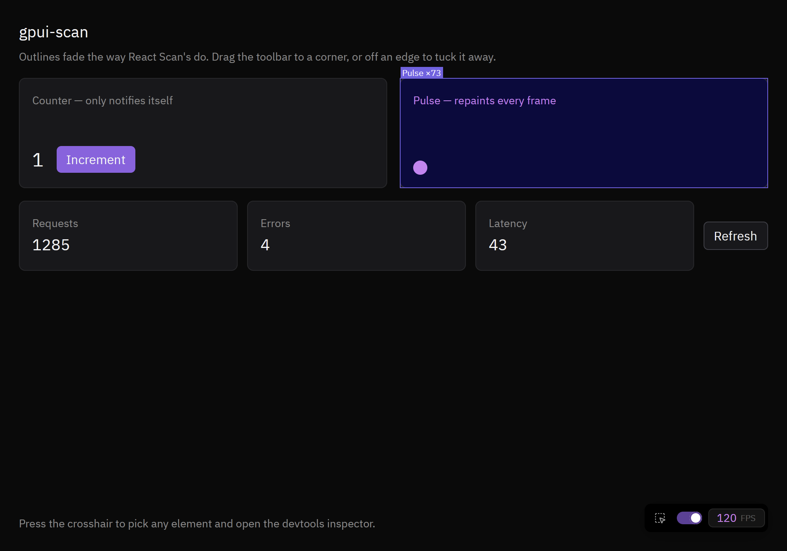
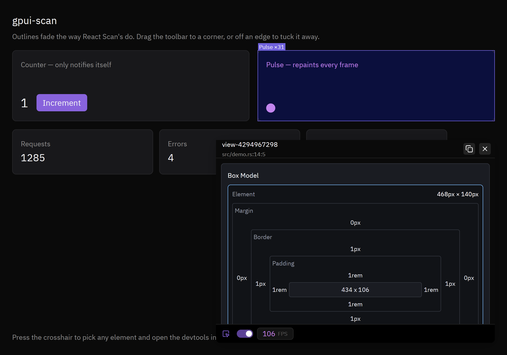

# gpui-scan

[](https://crates.io/crates/gpui-scan)
[](https://docs.rs/gpui-scan)
[](https://github.com/encryptedbusiness/gpui-scan/actions/workflows/ci.yml)
[](LICENSE)
[](Cargo.toml)

**React Scan for [GPUI](https://gpui.rs).** A floating overlay that outlines the views that
re-rendered just now, reports frame rate, and opens the
[gpui-devtools](https://github.com/joris-gallot/gpui-devtools) inspector for any element you pick.



## Features

- **Re-render outlines.** Every tracked view that called `cx.notify()` gets a purple outline with a
  `Name ×count` label. Outlines fade over 750ms and chase an element that moves.
- **Live FPS.** A frame-rate readout that turns amber under 50 and red under 30.
- **Element picker.** Click the crosshair, then any element. The widget grows into a 550×400
  inspector with the element's box model, style groups, and temporary edits — the full
  gpui-devtools panel, not a reimplementation.
- **Zero boilerplate tracking.** Add `#[gpui_scan::scan]` to a `Render` impl and render the entity
  normally. No call-site wrapper, and the tracking element is only built on frames that changed.
- **Leave it out of release builds.** The scanner is opt-in. Feature-gate the dependency and the
  generated code compiles down to a single atomic load.

## Install

```toml
[dependencies]
gpui = { package = "gpui-pre", version = "0.3" }
gpui-scan = "0.1"
```

Your application must resolve to the same `gpui-pre` version as `gpui-scan`; otherwise Cargo builds
two incompatible copies of GPUI. The scanner enables GPUI's `inspector` feature, so gate it behind
a development feature instead of shipping it in release builds:

```toml
[features]
scan = ["dep:gpui-scan"]

[dependencies]
gpui-scan = { version = "0.1", optional = true }
```

## Quick start

Install the scanner once, after the rest of the application:

```rust
app.run(|cx| {
    // Initialize the rest of the app first.

    #[cfg(feature = "scan")]
    gpui_scan::init(cx);
});
```

Add the attribute to the views whose updates should be attributed:

```rust
#[gpui_scan::scan]
impl Render for Counter {
    fn render(&mut self, _window: &mut Window, _cx: &mut Context<Self>) -> impl IntoElement {
        div().child(self.count.to_string())
    }
}
```

Render them like any other entity:

```rust
impl Render for App {
    fn render(&mut self, _window: &mut Window, _cx: &mut Context<Self>) -> impl IntoElement {
        gpui_scan::scan_root(
            div()
                .relative()
                .size_full()
                .child(self.sidebar.clone())
                .child(self.content.clone()),
        )
    }
}
```

`scan_root` pins the application to the window's full width, so the inspector floats over the
application instead of shrinking it. If you would rather let GPUI reserve space for the inspector,
use `gpui_scan::scan_layer()` as the last child of your root view; the layer is absolutely
positioned over the window and takes no part in the layout.

### Tracking from the call site

The attribute is optional. `track_view` and the `ScanTrackExt` methods track a view where it is
rendered, which is useful when the label has to be chosen at runtime:

```rust
div()
    .child(self.sidebar.scan_as("Sidebar", cx))
    .child(self.content.scan(cx))          // type name as the label
    .child(self.rows[i].scan_keyed("Row", i, cx)) // lists built from one call site
```

## The widget

The toolbar sits 24px in from the bottom-right corner. Drag it and, past 60px, it eases to the
corner the pointer moved toward; a shorter drag stays where you let go. Drag it mostly off an edge
and it tucks into a tab. Click the tab, or pull it back in, and it opens again. The bar drags; the
buttons do not.

| Control | Behavior |
| --- | --- |
| Inspect | Starts element picking. GPUI highlights whatever is under the pointer, and clicking opens that element in the widget. Click again, or press `Esc`, to leave picking. While an element is focused the icon stays lit, and `Esc` returns to picking. |
| Outline re-renders | Outlines every tracked view that was notified. |
| FPS | Frames per second. Under 30 is red, under 50 is amber, otherwise purple. It is a readout, not a button. |

Outlines are purple, one pixel, with a `Name ×count` label on the element's top edge. They fade
over 750ms. A view that keeps updating stays opaque, and an outline that moves chases its new
rectangle instead of jumping.

Picking is GPUI's own inspector pass, so every element is reachable, not just the tracked ones. The
scanner hides its own overlay while picking is active, because every element — a transparent
overlay included — takes part in that pass.

## The inspector



Selecting an element grows the toolbar into a 550×400 panel, easing upward from whichever corner it
is anchored to. The header shows the element's name and source location. Copy puts that location on
the clipboard and, after a moment, closes the panel; Close does it immediately. Drag any edge to
resize, and the size is remembered. The body is gpui-devtools' element panel, so the box model,
style groups, and temporary edits behave exactly as they do there.

## Configuration

`ToggleOutlines` is bound to `cmd-alt-s` (`ctrl-alt-s` elsewhere) and `CancelPick` to `escape`.
Configure the bindings, the starting switch state, or the palette with `Config`:

```rust
gpui_scan::init_with(
    gpui_scan::Config::default()
        .key_binding(None)
        .cancel_key_binding(None) // the application wants Escape for itself
        .outlines(true),
    cx,
);
```

## How updates are detected

GPUI rebuilds the whole element tree on every draw, so "this element was laid out again" says
nothing about whether anything changed. A view's `cx.notify()` is the only honest signal, so
tracking watches the entity.

- `#[gpui_scan::scan]` wraps the `render` method and reports the view on its first render and on
  every frame it was notified.
- The reported element wraps the view, so the outline lands exactly on its bounds.
- A frame that reuses everything — including the frames the toolbar itself asks for to keep the FPS
  reading alive — reports nothing.

With scanning disabled (no `init` and no overlay), the generated code is a single relaxed atomic
load and the element is returned untouched. With scanning enabled, an idle frame costs one map
access per tracked view; the tracking element is only built on frames that actually changed.

### Performance

Measured on Apple Silicon in release mode, with 120 frames per run over trivial one-pixel rows:

| Case | 500 tracked views | 2000 tracked views |
| --- | --- | --- |
| Idle frame, scanning on | 3–6µs/frame (~6–11ns/view) | 0–21µs/frame (~0–10ns/view) |
| Idle frame, scanning off | not measurable | not measurable |
| Every view notified each frame | ~79µs/frame (~159ns/view) | — |

The update path includes building the bounds-recording element and pushing one render record per
changed view. Real views cost far more to render than the row fixture, so the relative overhead is
smaller in practice.

The toolbar ticks a frame callback while a window is open so the FPS reading and outline fades stay
live. That is the cost of a HUD; like any devtool, gate it out of release builds.

## Compatibility

| | |
| --- | --- |
| Rust | 1.98+ (edition 2024) |
| GPUI | `gpui-pre` 0.3 |
| Platforms | macOS, Linux, Windows, and wasm |
| Inspector | Requires GPUI's `inspector` feature, enabled by this crate |

`init` installs the gpui-devtools inspector renderer, so call it after any library that registers
its own renderer, and do not also call `gpui_devtools::init`.

## Examples

```sh
# Native demo
cargo run -p gpui-scan-basic

# Web demo
examples/web/build.sh
python3 -m http.server -d examples/web/www 4173
```

Both demos share `examples/basic/src/demo.rs`. The web build needs
`rustup target add wasm32-unknown-unknown` and a `wasm-bindgen` CLI matching the crate version in
`Cargo.lock`. The browser has no system fonts, so the page registers the bundled IBM Plex Sans
face before the first frame.

## Contributing

Issues and pull requests are welcome. Read [CONTRIBUTING.md](CONTRIBUTING.md) for the local checks,
project layout, and release process. Security reports go through [SECURITY.md](SECURITY.md).

## License

MIT. See [LICENSE](LICENSE).
