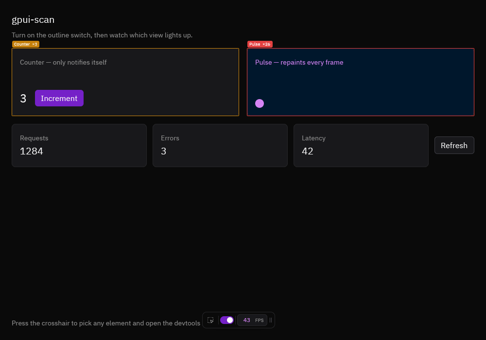
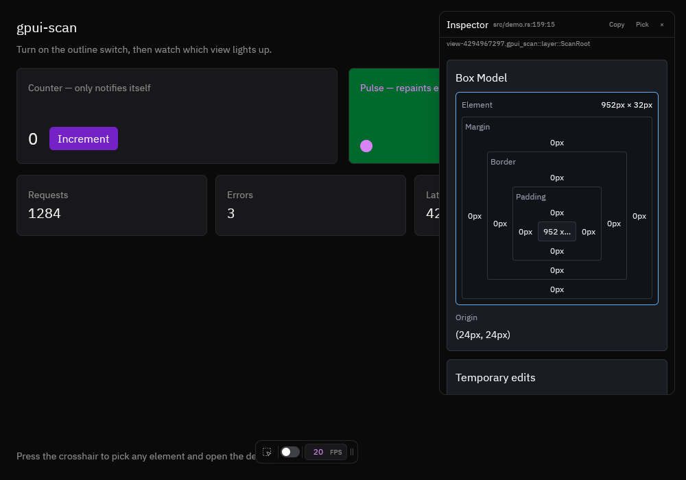

# gpui-scan

React Scan for [GPUI](https://gpui.rs): a floating toolbar that outlines everything that updated
just now, a live FPS readout, and an element picker that opens the
[gpui-devtools](https://github.com/joris-gallot/gpui-devtools) inspector for whatever you clicked.



## Install

```toml
[dependencies]
gpui = { package = "gpui-pre", version = "0.3" }
gpui-scan = "0.1"
```

Your application must resolve to the same `gpui-pre` crate as `gpui-scan`, otherwise Cargo builds
two incompatible copies. GPUI only builds its inspector with the `inspector` feature or in debug
builds, so gate the scanner behind a feature of your own to keep it out of release builds.

## Use

Install the scanner once, after the rest of your application:

```rust
app.run(|cx| {
    // Initialize the rest of the app first.

    #[cfg(feature = "scan")]
    gpui_scan::init(cx);
});
```

Wrap the root view with `scan_root` and track the views whose updates should be attributed:

```rust
impl Render for App {
    fn render(&mut self, _window: &mut Window, cx: &mut Context<Self>) -> impl IntoElement {
        gpui_scan::scan_root(
            div()
                .size_full()
                .child(self.sidebar.scan_as("Sidebar", cx))
                .child(self.content.scan(cx)), // uses the view's type name
        )
    }
}
```

`scan_root` pins the application to the window's full width, so the inspector floats over the
application instead of shrinking it. If you would rather let GPUI reserve space for it, add
`gpui_scan::scan_layer()` as the last child of your root view instead; the layer is absolutely
positioned over the window and takes no part in the layout.

## The toolbar

The widget sits 24px in from the bottom-right corner. Drag it and, past 60px, it eases to the
corner the pointer moved toward. A shorter drag stays where you let go. Drag it mostly off an
edge and it tucks into a tab; click the tab, or pull it back in, and it opens again. The whole
bar drags. The buttons do not.

| Control | Behavior |
| --- | --- |
| Inspect | Starts element picking. GPUI highlights whatever is under the pointer, and clicking opens that element in the widget. Click again, or press `Esc`, to leave picking. While an element is focused the icon stays lit, and `Esc` returns to picking. |
| Outline re-renders | Outlines every tracked view that was notified. |
| FPS | Frames per second. Under 30 is red, under 50 is amber, and the rest is the purple readout. It is not a button. |

Outlines are purple, one pixel, with a `Name ×count` label on the element's top edge. They fade
over 750ms. A view that keeps updating stays opaque, and an outline that moves chases its new
rectangle instead of jumping.

Picking is GPUI's own inspector pass, so hover highlighting and selection behave like
gpui-devtools: every element is reachable, not just the tracked ones. The scanner hides its own
overlay while picking is active, because every element — a transparent overlay included — takes
part in that pass. GPUI draws that hover highlight itself, so it stays GPUI's blue.

## The inspector



Selecting an element grows the toolbar into a 550×400 panel, easing upward from whichever corner
it is anchored to. The body is gpui-devtools' element panel, so the box model, style groups and
temporary edits are unchanged. The header shows the element's name and source location. Copy puts
that location on the clipboard and, after a moment, closes the panel. Close does it immediately.
Drag any edge to resize; the size is remembered.

`ToggleOutlines` is bound to `cmd-alt-s` (`ctrl-alt-s` elsewhere) and `CancelPick` to `escape`.
`CancelPick` leaves picking and starts a new pick when an element is focused. Configure both, or
the starting switch state, with `Config`:

```rust
gpui_scan::init_with(
    gpui_scan::Config::default()
        .key_binding(None)
        .cancel_key_binding(None) // the application wants Escape for itself
        .outlines(true),
    cx,
);
```

## How updates are detected

GPUI rebuilds the whole element tree on every draw, so "this element was laid out again" says
nothing about whether anything changed. A view's `cx.notify()` is the only honest signal, so
tracking watches the entity:

- `track_view(&entity, cx)` subscribes to the view and reports it when it was notified.
- The reported element wraps that view, so the outline lands exactly on its bounds.
- A frame that reuses everything — including the frames the toolbar itself asks for to keep the
  FPS reading alive — reports nothing.

That means a tracked view corresponds to a view boundary: put `track_view` around the entities you
would call components, not around arbitrary `div`s inside one view's `render`.

## Web

The crate is wasm-friendly, and `examples/web` renders the demo in a browser:

```sh
examples/web/build.sh          # cargo build for wasm32 + wasm-bindgen
python3 -m http.server -d examples/web/www 4173
```

Two details the web platform needs:

- `gpui_platform::web_init()` installs the panic hook and logger; `single_threaded_web()` avoids
  the nightly-only `wasm_thread` machinery.
- The browser has no system fonts. Register a face for the family GPUI resolves the system font to
  (`IBM Plex Sans`) before the first frame, or the first text measurement panics.

## Notes

- `init` installs the gpui-devtools inspector renderer, so call it after any library that
  registers its own renderer, and do not also call `gpui_devtools::init`.
- The overlay steps out of the way while the inspector is picking, since every element — including
  a transparent overlay — takes part in picking. The toolbar is drawn by the inspector itself
  while an element is focused, because that column is painted on top of the right side of the
  window and would otherwise eat every click on the widget.
- The toolbar ticks a frame callback for as long as a window is open so the FPS reading and the
  outline fades stay live. That is the cost of a HUD; gate it out of release builds like any other
  devtool.

## License

MIT
